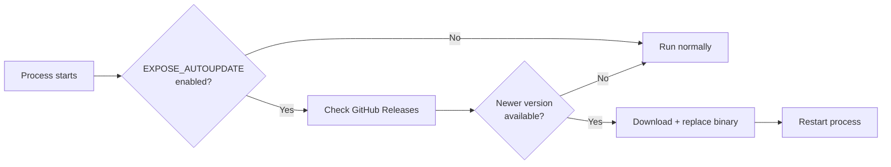

# Auto-Update

expose supports automatic self-update for both the server and client binaries.

## How It Works



When auto-update is enabled:

1. **On startup** - checks for a newer release and updates before proceeding
2. **Periodically** - checks every 30 minutes in the background
3. **On server version change** - if the client detects the server upgraded (via registration response), it triggers an immediate update check
4. **On newer client registration** - if a client registers with a newer version than the server, the server triggers an immediate update check. Client-triggered checks are limited to once per minute.

Updates run inside the existing process. There is no resident updater or supervisor.
The updater checks the release checksum manifest first, verifies its signature when
required, then downloads and verifies the archive. It rejects invalid Go executables
and binaries built for a different OS or architecture before replacing anything.

The new executable is written and synced in a private temporary directory beside
the installed binary. Linux and macOS install it using an atomic rename, shut down
the service, then use `exec` to replace the process image. The PID, arguments, and
environment stay the same, including when expose is container PID 1. This is a
restart, not a live migration of connections or in-memory state. Active tunnels
can disconnect during the restart.

Windows first renames the old executable into the update directory, then installs
the verified replacement with the old executable's access grants. A failed install
attempt restores the old path when possible. After service shutdown, expose starts
the new executable with an inherited handle to the old process. The replacement
waits up to 30 seconds for the old process to exit, removes its old executable when
possible, then runs the original command with the original environment. The PID
changes, but no separate updater remains. Windows service wrappers must support
this process handoff; expose does not implement an SCM service restart.

An exclusive OS lock rejects concurrent updates of the same installed path before
they download archives. The small `<executable>.update.lock` file is retained so all
updaters lock the same file; the OS releases the lock on process exit. Updates have
a five-minute overall apply deadline, shortened by caller deadlines. Cancellation
before installation leaves the installed executable untouched. Replacement never
falls back to deleting the installed file and copying into its live path.

There is no automatic rollback after a replacement fails to start. Use your service
manager's restart policy for startup failures. On Windows, manual `expose update`
or another running invocation may leave a locked `previous.exe` in a
`.expose-update-*` directory beside the installation. That directory can be removed
after the processes using the old executable exit.

## Enabling Auto-Update

Set the environment variable:

```bash
export EXPOSE_AUTOUPDATE=true
```

Accepted values: `true`, `1`, `yes` (case-insensitive).

For a fail-closed supply-chain policy, install `cosign` and also set:

```bash
export EXPOSE_REQUIRE_SIGNATURE=true
```

With this setting, updates are rejected unless the release checksum manifest
has a valid Sigstore bundle issued to this repository's tagged release
workflow at the exact selected release tag. The update is rejected rather than
falling back to checksum-only verification when `cosign` or the signature bundle
is unavailable. Automatic checks log the failure and keep the current version running.

This works for `expose server`, `expose http`, and `expose static`. It is not supported by `expose up`.

### In a systemd service

```ini
[Service]
Environment=EXPOSE_AUTOUPDATE=true
```

> **Note on file capabilities**: On Linux, the updater preserves file capabilities when `getcap` and `setcap` are available and permitted. Otherwise, capabilities such as `cap_net_bind_service` may need to be reapplied after an update. Systemd `AmbientCapabilities=CAP_NET_BIND_SERVICE` avoids tying the capability to the replaced file.

## Manual Update

Check for updates and apply interactively:

```bash
expose update
```

This shows the current and available versions, prompts for confirmation (in interactive terminals), then downloads and replaces the binary.

## Hotkey Update (Client)

While the client dashboard is running, press **Ctrl+U** to trigger an immediate update check and apply. The dashboard shows update availability:

```
  Update      v1.2.0 available - run expose update or press Ctrl+U
```

## Development Builds

Development builds support auto-update when `EXPOSE_AUTOUPDATE=true`, including startup, periodic, and version-change checks. Manual updates and Ctrl+U work too.

Versioned development builds compare their base version with the latest published release. For example, `v1.2.9-dev` and `v1.2.9-3-gabc123-dev` update to `v1.2.10`, but not to `v1.2.9` or an older release. A plain `dev` build has no version baseline and updates to the latest published release. Unrecognized version strings are ignored.

## Binary Placement

For auto-update to work, the binary must be in a directory where the running user
has **write permission**. The updater must create its staging directory and lock
file beside the executable. Symlinked installations update their resolved target.
Read-only directories and bind-mounted executable files can prevent replacement;
update the container image instead when its executable cannot be renamed.

| Placement            | Auto-update works? | Notes                             |
| -------------------- | ------------------ | --------------------------------- |
| `/opt/expose/.local/bin/` | Yes           | Recommended for systemd services  |
| `./bin/expose`       | Yes                | Local development                 |
| `/usr/local/bin/`    | Only as root       | Not recommended with auto-update  |

## See Also

- [VPS Deployment](vps-deployment.md) - systemd setup with auto-update
- [Client Dashboard](client-dashboard.md) - update notifications in the UI
